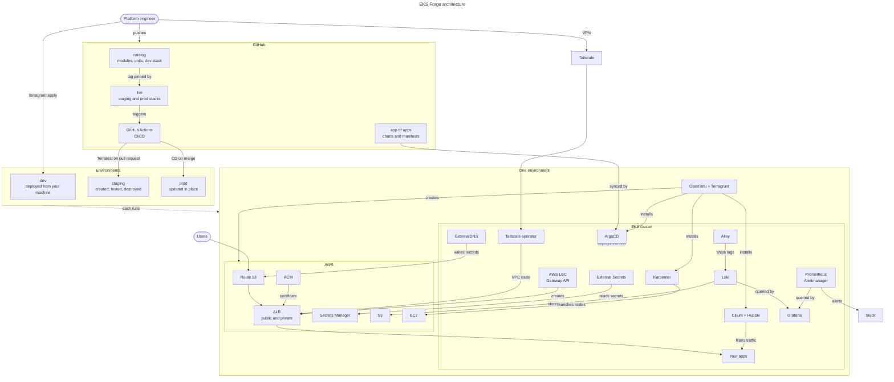

  <picture>
    <source media="(prefers-color-scheme: dark)" srcset="site/static/img/readme-banner-dark.png">
    
  </picture>

  An open-source platform for building and operating Kubernetes on AWS

  <a href="https://eks-forge.readthedocs.io/latest/docs/quickstart/">Quickstart</a>&nbsp;|&nbsp;
  <a href="https://eks-forge.readthedocs.io/latest/docs/overview/">Documentation</a>

  
  
  
  

EKS Forge is a production-ready EKS platform that you can understand, extend, and operate yourself. It's a template you fork, not a dependency you install, and you can have it running in about a day.

## What's Inside

- [Infrastructure as code](https://eks-forge.readthedocs.io/latest/docs/iac/) (IaC) with OpenTofu and Terragrunt
- Deploy the same stack across multiple IaC [environments](https://eks-forge.readthedocs.io/latest/docs/iac/#environments) (`dev`, `staging`, and `prod`)
- GitOps with ArgoCD using the [App of Apps pattern](https://eks-forge.readthedocs.io/latest/docs/applications/how-the-app-of-apps-works/)
- [Node autoscaling](https://eks-forge.readthedocs.io/latest/docs/compute/how-pods-are-scheduled/) with Karpenter
- [Monitoring](https://eks-forge.readthedocs.io/latest/docs/monitoring/how-monitoring-works/) and alerting with Prometheus, Grafana, and Loki
- [Network policies](https://eks-forge.readthedocs.io/latest/docs/security/how-network-policies-work/) with Cilium
- [CI/CD](https://eks-forge.readthedocs.io/latest/docs/ci-cd/) with GitHub Actions

For the full list, see [Features](https://eks-forge.readthedocs.io/latest/docs/overview/#features).

## Get Started

Four tutorials walk you through the platform, in order:
1. [Quickstart](https://eks-forge.readthedocs.io/latest/docs/quickstart/): deploy a [fully-fledged](https://eks-forge.readthedocs.io/latest/docs/overview/#cluster-features) EKS cluster in the `dev` environment
2. [Monitor Your Cluster](https://eks-forge.readthedocs.io/latest/docs/monitoring/get-started/): explore its metrics, logs, network flows, and alerts
3. [Deploy Your Applications](https://eks-forge.readthedocs.io/latest/docs/applications/get-started/): ship a change to the cluster through ArgoCD
4. [Production Deployment](https://eks-forge.readthedocs.io/latest/docs/deployment/get-started/): test on `staging`, then promote a release to `prod`

## Architecture

Three repositories deploy the same stack to `dev`, `staging`, and `prod`: Terragrunt provisions AWS and the cluster, and ArgoCD deploys what runs inside it. For how the pieces fit together, see [Architecture](https://eks-forge.readthedocs.io/latest/docs/architecture/).

## Support

Support is provided on a best-effort basis. If you have feedback, feature ideas, or wish to report a bug, please use the [issues](https://github.com/ConsciousML/eks-forge/issues) of this repository.

## License

EKS Forge is licensed under the [Apache License 2.0](LICENSE).
