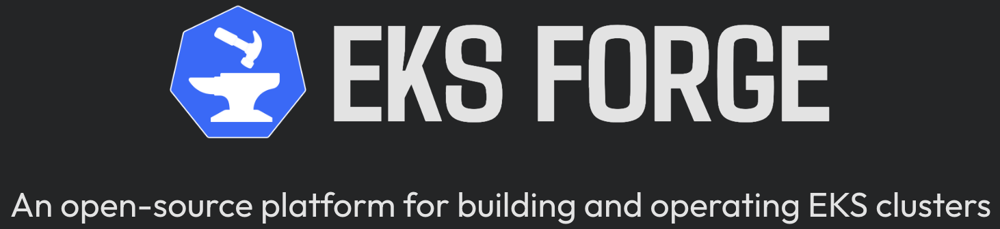

EKS Forge is an open-source platform for building and operating EKS clusters

To work on this documentation site, see [Set Up the Documentation Repository](https://eks-forge.readthedocs.io/latest/docs/documentation/set-up-the-documentation-repository/).
