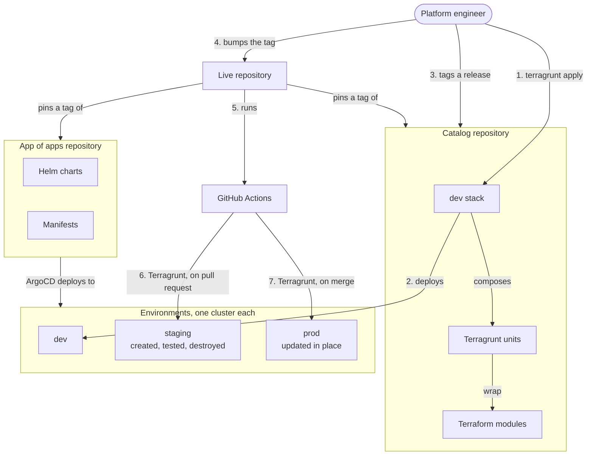
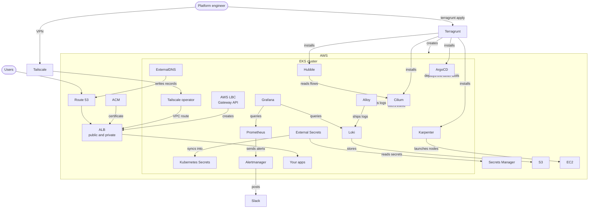
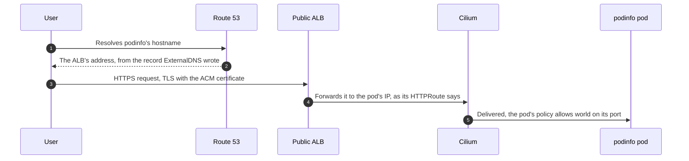

# Architecture

EKS Forge has two sides: the platform, with the repositories and pipelines that deploy to `dev`, `staging`, and `prod`, and the infrastructure, with the AWS resources and the tools running in each environment's cluster. This page shows how the pieces of each side fit together, and points to the page that explains each one.

## Platform Architecture

Each part of the diagram has a page of its own:
- **Repositories**: the catalog provisions AWS, the app of apps repository holds what runs in the cluster, and the live repository pins both for `staging` and `prod` (see [Who Owns What](/docs/applications/how-the-app-of-apps-works/#who-owns-what)).
- **Infrastructure as code**: Terraform modules, wrapped in Terragrunt units, composed into stacks (see [Infrastructure as Code](/docs/iac/)).
- **Environments**: the same stack runs in all three, with different values (see [Environments](/docs/iac/#environments)).
- **Pipelines**: CI tests a change on `staging`, and CD applies it to `prod` (see [CI/CD](/docs/ci-cd/)).
- **GitOps**: ArgoCD deploys every chart and manifest of the app of apps repository (see [How the App of Apps Repository Works](/docs/applications/how-the-app-of-apps-works/)).

## Infrastructure Architecture

Terragrunt runs first: it creates the AWS resources and the cluster, then installs the few components ArgoCD can't deploy itself:
- ArgoCD, and its root Application, which points at the app of apps repository.
- Cilium, with Hubble, so Cilium manages every pod ArgoCD deploys, and Karpenter nodes can drop their startup taint (see [Pods Cilium Doesn't Manage](/docs/security/how-network-policies-work/#pods-cilium-doesnt-manage)).
- Karpenter, since ArgoCD itself runs on its `critical` nodes (see [Three Kinds of Nodes](/docs/compute/how-pods-are-scheduled/#three-kinds-of-nodes)).

ArgoCD then deploys everything else from the app of apps repository: the AWS Load Balancer Controller, ExternalDNS, the External Secrets Operator, the monitoring stack, the Tailscale operator, and your apps.

Most of them also need AWS resources: an IAM role, an S3 bucket, a secret, or a certificate. Terragrunt creates these first, so they exist when ArgoCD deploys the component that uses them. It then hands their names and ARNs to ArgoCD's root Application, which passes each one to its chart (see [`appParams` Injection](/docs/applications/how-the-app-of-apps-works/#appparams-injection)).

Each part of the diagram has a page of its own:
- **Compute**: Karpenter launches the nodes your pods run on (see [How Pods Are Scheduled](/docs/compute/how-pods-are-scheduled/)).
- **Network security**: Cilium denies all traffic by default, and allows each flow a pod needs (see [How Network Policies Work](/docs/security/how-network-policies-work/)).
- **Private access**: Tailscale lets developers reach the internal tools (see [Tailscale](/docs/security/tailscale/)).
- **Observability**: Prometheus collects metrics, Alloy ships logs to Loki, Hubble shows the flows Cilium sees, and Alertmanager sends alerts to Slack (see [How Monitoring Works](/docs/monitoring/how-monitoring-works/) and [How Alerting Works](/docs/monitoring/alerting/how-alerting-works/)).

### How an External Request Flows Through the Cluster
A request to one of your apps goes through several tools of the diagram. Each one sets up a single link of the chain:

- The AWS Load Balancer Controller creates the ALB from the public `Gateway`, with the ACM certificate the catalog issued.
- An app's `HTTPRoute` attaches it to that `Gateway` under its hostname, and ExternalDNS writes that hostname into Route 53.
- The ALB sends the request straight to the pod's IP. Cilium sees it come from outside the cluster, so the pod's network policy has to allow `world` on its port (see [The `world` Entity](/docs/security/how-network-policies-work/#the-world-entity)).

The internal tools, like ArgoCD, Grafana, and Hubble, follow the same chain through the private `Gateway`. Its ALB is internal, and its hostnames sit in a private Route 53 zone, so neither can be reached from the internet. Developers reach them over Tailscale: the operator's connector advertises the VPC as a route of the tailnet, and split DNS resolves the private hostnames (see [Connector and Split DNS](/docs/security/tailscale/#4-connector-and-split-dns)).
