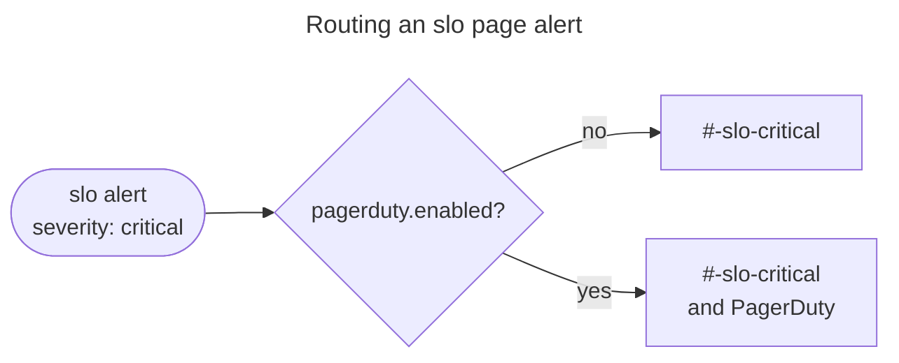
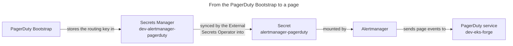

# How Paging Works

EKS Forge pages the person on call through [PagerDuty](https://www.pagerduty.com/), but only for SLO page alerts, and only in the environments that turn paging on. Every other alert stays in Slack. This page explains why, and how a page reaches PagerDuty.
To get paged yourself, follow [Get Your First Page](/docs/monitoring/get-started/paging/). To choose who gets paged, see [Manage On-Call in PagerDuty](/docs/monitoring/paging/manage-on-call-in-pagerduty/).

## Why Only SLO Alerts Page
Of all the alerts EKS Forge ships, only the page alert of an SLO reaches PagerDuty. A page notifies the person on call at any hour, so it's kept for the alerts that need someone immediately (see [Pages and Tickets](/docs/monitoring/paging/how-slo-alerting-works/#pages-and-tickets) and [Multi-Window Multi-Burn-Rate Alerts](/docs/monitoring/paging/how-slo-alerting-works/#multi-window-multi-burn-rate-alerts)).

The reason is that an SLO alert reports a symptom, not a cause. When podinfo's page alert fires, its users are getting errors now, and fast enough to burn the error budget in days. A cause alert like `KubePodCrashLooping` says something is wrong in the cluster, not that anyone notices. A replica can restart in a loop while the others serve every request. The SRE book draws the same line in [Symptoms Versus Causes](https://sre.google/sre-book/monitoring-distributed-systems/#symptoms-versus-causes-g0sEi4).

Every other alert stays in its Slack channel, the SLO ticket alerts included (see [How Alerting Works](/docs/monitoring/alerting/how-alerting-works/)). They help once someone is paged: the page says users are failing, and the cause alerts in Slack say why.

The trade-off is that a cause that will hurt users later, like a disk filling up, pages nobody until it burns the error budget. Until then, it only reaches Slack, so someone still has to read the `critical` channels.

## Paging Is Opt-In per Environment
The `slo` alerts with `severity: critical` have a route of their own in Alertmanager, like every pair of `component` and `severity` (see [Routing by Component, Then Severity](/docs/monitoring/alerting/how-alerting-works/#routing-by-component-then-severity)). The `pagerduty.enabled` value of the `kube-prometheus-stack` chart picks its receiver. When the value is off, the route uses `slo-critical`, which posts to `#<environment>-slo-critical`. When it's on, the route uses `slo-critical-pagerduty`, which posts to the same channel and also pages PagerDuty.

Each environment's EKS stack sets the value. In the catalog, the `dev` stack reads it from [`PAGERDUTY_ENABLED`](/docs/reference/environment_variable/#pagerduty_enabled), which defaults to `false`. A `dev` cluster is rebuilt and broken on purpose, and CI deploys the same stack to test a change, so neither should wake anyone by default. In the live repository, `prod` sets it to `true` and `staging` to `false`, since only `prod` serves real users.

## From the Routing Key to a Page
PagerDuty takes alerts through its [Events API v2](https://developer.pagerduty.com/docs/events-api-v2-overview), and each event names a [service](https://support.pagerduty.com/main/docs/services-and-integrations) by its routing key, also called its integration key. The [PagerDuty Bootstrap](/docs/quickstart/bootstrap/pagerduty/) creates one service per environment, like `dev-eks-forge`, with an Events API v2 integration. It stores the integration's key as `routing_key`, in the `<environment>-alertmanager-pagerduty` secret of AWS Secrets Manager.

The key reaches Alertmanager like the Slack bot token does. Through the `alertmanager-pagerduty-secrets` app, the [External Secrets Operator](https://external-secrets.io/) syncs it into the `alertmanager-pagerduty` Secret of the `monitoring` namespace. Alertmanager mounts that Secret, and the `slo-critical-pagerduty` receiver reads the key from that file with `routing_key_file`. The key never sits in git or in the Helm values.

Every environment gets a service and a secret, those that never page included. Alertmanager mounts the `alertmanager-pagerduty` Secret whatever `pagerduty.enabled` says, and its pod doesn't start until the Secret exists. Turning paging on is then only a change of value, with no bootstrap to run first.

Neither `pagerduty.enabled` nor `pagerduty.eventsUrl` is written in the app of apps repository. The catalog fills both at deploy time, like the environment prefix of the channels (see [`appParams` Injection](/docs/applications/how-the-app-of-apps-works/#appparams-injection)).

## The Service Region
A PagerDuty account lives in the US or in the EU, chosen at signup, and each region has its own Events API endpoint. Alertmanager has to send its events to your account's region, so the catalog turns [`PAGERDUTY_SERVICE_REGION`](/docs/reference/environment_variable/#pagerduty_token-and-pagerduty_service_region) into `pagerduty.eventsUrl`: the EU endpoint for `eu`, and the US one otherwise.
## Incidents Open and Close Themselves
Alertmanager sends a trigger event when the page alert fires, and PagerDuty opens an incident on the environment's service. The incident's title is the alert's `summary` annotation, like `podinfo is burning its availability error budget`. The person on call often reads only that, on a lock screen, so a summary has to make sense on its own.

The receiver also sets `send_resolved`. When the alert resolves, Alertmanager sends a resolve event, and PagerDuty resolves the incident. Nobody has to close it by hand.

The limit is that only an Alertmanager that still routes to PagerDuty sends that event. If paging is turned off while an incident is open, nothing closes it.

For the values behind the PagerDuty receiver, see the [`kube-prometheus-stack` Helm Chart](/docs/reference/helm_charts/monitoring/kube-prometheus-stack/) reference. For the pipeline that creates the services, see the [PagerDuty Service](/docs/reference/bootstrap/pagerduty_service/) reference.
