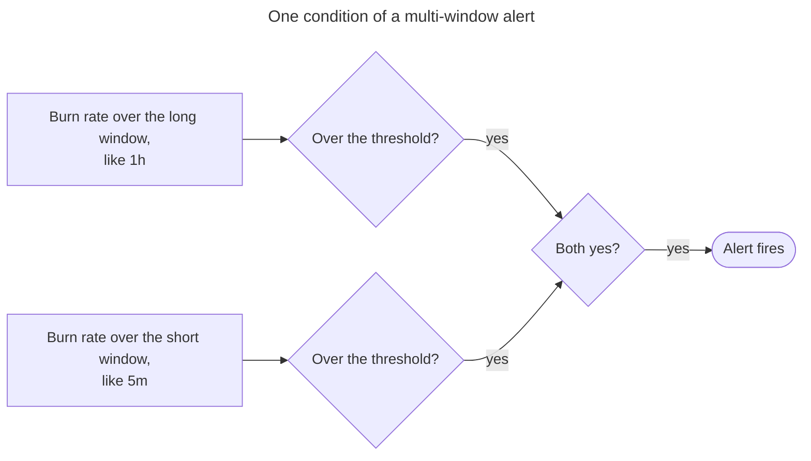
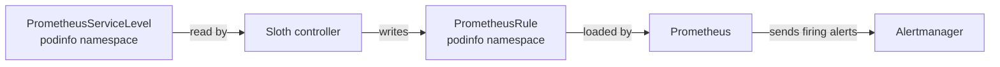

# How SLOs Work

Podinfo has two service level objectives (SLOs), one for availability and one for latency. [Sloth](https://sloth.dev/) turns each one into two alerts: a page, for when someone must act now, and a ticket, for when it can wait. This page explains the model behind them, and the maths that decides when each one fires.
To watch one fire, follow [Get Your First Page](/docs/monitoring/paging/get-your-first-page/).

## Service Level Indicator
A service level indicator (SLI) measures how well a service does, from its users' side. Sloth writes it as a ratio: the bad events over all the events, in a time window. For podinfo's availability, that's the requests that failed with a `5xx` over every request. The SLI is then an error ratio, between `0` (nothing failed) and `1` (everything did).

A ratio, not a count, because a count grows with traffic. Fifty failed requests are an outage at a hundred requests a minute, and noise at a hundred thousand. A ratio means the same thing at any traffic.

Each SLO gives Sloth the two halves of the ratio as PromQL queries, `errorQuery` and `totalQuery`, in [`manifests/podinfo/podinfo-slo.yaml`](https://github.com/ConsciousML/eks-forge-app-of-apps/blob/main/manifests/podinfo/podinfo-slo.yaml) for podinfo:
```yaml
sli:
  events:
    errorQuery: sum(rate(http_request_duration_seconds_count{namespace="podinfo", path!~"healthz|readyz|metrics", status=~"5.."}[{{.window}}]))
    totalQuery: sum(rate(http_request_duration_seconds_count{namespace="podinfo", path!~"healthz|readyz|metrics"}[{{.window}}]))
```

`{{.window}}` isn't a fixed duration. Sloth fills it in once per window it needs, from five minutes to thirty days, so one query gives the SLI over every window the alerts look at.

Both queries leave out `/healthz`, `/readyz`, and `/metrics`. The kubelet probes and Prometheus call them all the time, and they always answer fast with a `200`. Counting them would add good events no user made, and both SLIs would look better than what users see.

For more on choosing what to measure, see [Indicators](https://sre.google/sre-book/service-level-objectives/#indicators) in Google's SRE book.

## Service Level Objective
An SLO is the target the SLI must meet over a period. Podinfo's availability SLO reads: 99% of requests return something other than a `5xx`, over 30 days. Sloth's `objective: 99` is the share of good events, so the error ratio over the period must stay at or under 1%.

The period is 30 days, Sloth's default, and it rolls: at any moment, it's the last 30 days. A long period smooths out a bad minute, and comes closer to how users judge a service: by how it has behaved lately, not in the last five minutes.

The objective is never 100%. No service gets there: a node goes down, a deployment restarts a pod, a network hop drops a packet. Aiming for it would mean freezing every change, for a gain users can't tell apart from 99.9%. Google's SRE book makes this case in [Embracing Risk](https://sre.google/sre-book/embracing-risk/), and the SRE workbook covers picking a target in [Implementing SLOs](https://sre.google/workbook/implementing-slos/).

## Error Budget
The error budget is what's left once the objective is met: `1 - objective`. For a 99% SLO, it's 1% of the requests over 30 days. At a million requests a month, 10,000 of them may fail without breaking the SLO.

A budget turns "be reliable" into an amount you can spend. A risky release, an experiment, or an incident each spends some of it. While budget is left, the team can keep shipping. Once it's gone, reliability work comes first. The SRE workbook writes this down as an [Error Budget Policy](https://sre.google/workbook/error-budget-policy/).

## Error Rate and Burn Rate
The error rate is the SLI measured over a window shorter than the period, like the share of requests that failed in the last hour. It says how the service does right now, where the SLO looks at the whole 30 days.

The burn rate compares that error rate to the error budget: how fast the service spends its budget. At a burn rate of `1`, it fails exactly as often as the budget allows, and spends it all in 30 days. At `2`, it spends it in 15 days. At `14.4`, in about 50 hours.

```text
burn rate = error rate / error budget = error rate / (1 - objective)
```

For podinfo's 99% SLO, an hour in which 14.4% of the requests failed gives `0.144 / 0.01 = 14.4`.

The alerts watch the burn rate, not the error rate, because an error rate means nothing without its SLO. A 2% error rate burns a 99% SLO at `2`: it'll last two weeks. It burns a 99.9% SLO at `20`: it'll be gone in a day and a half. The burn rate puts every SLO on the same scale, so the same thresholds fit them all.

## Multi-Window Multi-Burn-Rate Alerts
The simplest alert fires when the burn rate goes over a threshold in one window. Whatever the window, it gets something wrong. A short window reacts fast, but pages for a minute of errors that cost almost no budget. A long window only fires on real problems, but late, and keeps firing for hours after the errors stop. The SRE workbook goes through this trade-off one attempt at a time, in [Alerting on SLOs](https://sre.google/workbook/alerting-on-slos/), and ends on the design Sloth uses: multiple windows, and multiple burn rates.

Multiple burn rates, because failures come at different speeds. An outage burns the budget at a high rate: a high threshold over a short window catches it within minutes. A slow leak, like a small share of requests failing for days, never reaches that threshold, yet spends the budget just the same. A low threshold over a long window catches it.

Multiple windows, because each condition checks its burn rate over two of them, a long one and a short one, and fires only when both are over the threshold. The long window says enough budget was spent to matter. The short window, a twelfth of the long one, says it's still being spent. Once the errors stop, the short window drops below the threshold long before the long one does, and the alert resolves, even though the long window still holds the errors.



Sloth uses four conditions, the SRE workbook's [recommended parameters](https://sre.google/workbook/alerting-on-slos/#recommended_parameters_for_an_slo_based_a) for a 30-day SLO. Each one fires once a given share of the budget is spent over its long window:

| Alert | Burn rate | Long window | Short window | Budget spent over the long window |
|---|---|---|---|---|
| Page | 14.4 | 1 hour | 5 minutes | 2% |
| Page | 6 | 6 hours | 30 minutes | 5% |
| Ticket | 3 | 1 day | 2 hours | 10% |
| Ticket | 1 | 3 days | 6 hours | 10% |

Each alert fires when either of its two conditions does. These are Sloth's defaults, and the [`sloth` Helm Chart](/docs/reference/helm_charts/monitoring/sloth/) reference lists the ones EKS Forge uses.

The trade-off is low traffic. The burn rate is a ratio, so when few requests come in, a handful of failures is a large share of them. That's why two minutes of `500`s in [Get Your First Page](/docs/monitoring/paging/get-your-first-page/) fire both alerts: on a `dev` cluster, almost every request in the window is one of yours. A real service with steady traffic needs a real outage to get there.

## Page and Ticket Severities
A page carries `severity: critical`. It fires on the two fast conditions, at a burn rate of `14.4` or `6`, when the budget would be gone within days. Someone has to act now, at any hour.

A ticket carries `severity: warning`. It fires on the two slow conditions, at a burn rate of `3` or `1`: the budget is leaking, and lasts ten days at best. That leaves time to fix it during working hours.

While a page fires, its ticket is muted. Both alerts of an SLO share the same `alertname`, and the [inhibit rules](https://prometheus.io/docs/alerting/latest/configuration/#inhibition-related-settings) that `kube-prometheus-stack` ships by default mute a `warning` while a `critical` with the same `alertname` fires. The ticket would only repeat what the page already said.

## How Sloth Generates the Rules
Written by hand, each SLO would take a recording rule per window to compute its SLI, and two alerts that combine eight of them against thresholds derived from the objective. A typo in one window breaks an alert without a sign. [Sloth](https://sloth.dev/) generates all of them from a short spec, the same way for every SLO.

The spec is a `PrometheusServiceLevel`, a custom resource. The Sloth controller watches them, and writes a [`PrometheusRule`](https://prometheus-operator.dev/docs/api-reference/api/#monitoring.coreos.com/v1.PrometheusRule) next to each one, in the same namespace. Prometheus loads it like any other rule.



The `PrometheusRule` holds three kinds of rules:
- **SLI recording rules**: the error ratio over each window, like `slo:sli_error:ratio_rate5m` and `slo:sli_error:ratio_rate1h`.
- **Metadata recording rules**: the objective, the burn rate, and the budget left over the period, like `slo:period_error_budget_remaining:ratio`.
- **Alerts**: the page and the ticket, each combining two pairs of SLI recording rules.

Every rule carries the `sloth_service` and `sloth_slo` labels, which tell the SLOs apart. For the full list, see Sloth's [SLI rules](https://sloth.dev/slo-plugins/core/sli_rules_v1/), [metadata rules](https://sloth.dev/slo-plugins/core/metadata_rules_v1/), and [alert rules](https://sloth.dev/slo-plugins/core/alert_rules_v1/) plugins.

Each app ships its `PrometheusServiceLevel` next to its own manifests, like podinfo's `podinfo-slo.yaml`. Its SLOs then deploy, change, and go away with the app, and the `sloth` app needs no change for a new one. That's why the CRD isn't installed by the `sloth` chart, but by its own `crds-sloth` application, which syncs before any app (see [Sync Waves](/docs/applications/how-the-app-of-apps-works/#sync-waves)). An app's `PrometheusServiceLevel` would otherwise fail to apply until the `sloth` app had synced.

Every SLO labels its alerts `component: slo`, whatever app it's about. SLO alerts report a symptom users feel, not the part of the platform that caused it, so they get routes of their own, apart from the cause-based alerts of each component (see [Routing by Component, Then Severity](/docs/monitoring/alerting/how-alerting-works/#routing-by-component-then-severity)).

## Podinfo's SLOs
Podinfo has two SLOs, both at 99% over 30 days:
- **`requests-availability`**: requests that don't fail with a `5xx`. Its alert is `PodinfoAvailabilityBudgetBurn`.
- **`requests-latency`**: requests that complete in 100ms or less. Its alert is `PodinfoLatencyBudgetBurn`.

The latency SLI counts slow requests by subtraction: all requests, minus those in the `le="0.1"` bucket of the `http_request_duration_seconds` histogram. A Prometheus histogram only counts requests under each of its bucket boundaries, so the threshold has to be one of them. Moving it from 100ms means picking another boundary podinfo already exposes, not any duration.

Podinfo is a sample app, so its SLOs are examples. A fork writes its own, next to each of its apps' manifests. For the files behind podinfo's, see the [`podinfo` Manifests](/docs/reference/manifests/podinfo/) reference.

## The SLO Dashboards
Grafana's **SLOs** folder holds two of Sloth's community dashboards. [High level Sloth SLOs](https://grafana.com/grafana/dashboards/14643-high-level-sloth-slos/) shows every SLO at a glance. [SLO / Detail](https://grafana.com/grafana/dashboards/14348-slo-detail/) shows one SLO at a time: its SLI, its burn rate, and the budget it has left.

Both are built on Sloth's recording rules and their `sloth_service` and `sloth_slo` labels, not on any app's metrics. A new `PrometheusServiceLevel` then shows up in them with no dashboard change. For how dashboards get into Grafana, see [Add a Grafana Dashboard](/docs/monitoring/add-a-grafana-dashboard/).
