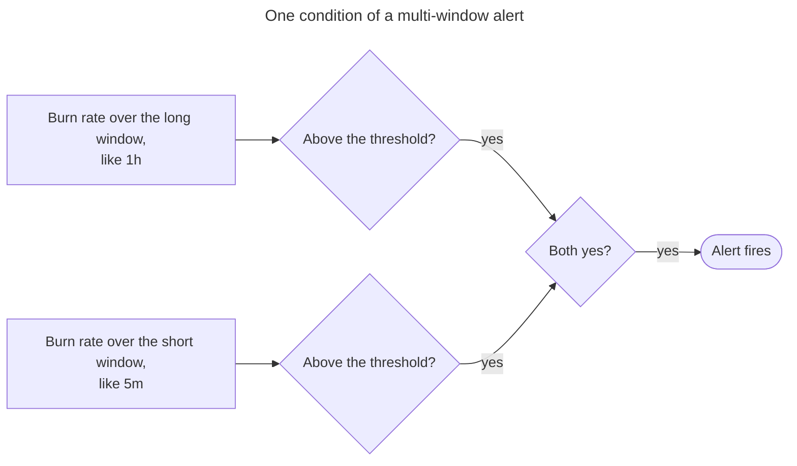
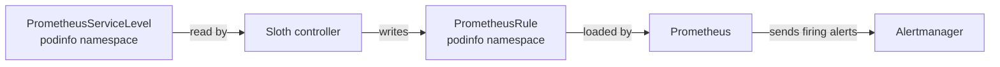

# How SLOs Work

EKS Forge alerts on podinfo's service level objectives (SLOs) through [Sloth](https://sloth.dev/), which turns each SLO into a page alert and a ticket alert. This page explains the concepts behind them, from the SLI to the burn rate, and how Sloth applies them.
To see a page alert fire, follow [Get Your First Page](/docs/monitoring/paging/get-your-first-page/).

## Service Level Indicator (SLI)
A [service level indicator](https://sre.google/sre-book/service-level-objectives/#indicators-o8seIAcZ) (SLI) measures one aspect of the service that is provided, like the share of requests that succeed or how fast they complete. The SRE workbook recommends writing it as the ratio of good events over total events. The alerts on this page use its complement, the error ratio:

```text
SLI = bad events / total events
```

It ranges from `0`, when no event failed, to `1`, when every event did.

For podinfo's availability, a bad event is a request that fails with a `5xx`. If podinfo serves 2,000 requests in an hour and 10 of them fail, its SLI over that hour is `10 / 2000 = 0.005`, or 0.5%.

Counting failures alone wouldn't work, because the count grows with traffic. Fifty failed requests are an outage at a hundred requests a minute, and noise at a hundred thousand. Dividing by the total gives the SLI the same meaning at any traffic level.

For how to pick what to measure, see [Indicators in Practice](https://sre.google/sre-book/service-level-objectives/#indicators-in-practice-pWs7iE) in the SRE book.

## Service Level Objective (SLO)
An [SLO](https://sre.google/sre-book/service-level-objectives/#objectives-g0s1tdcz) is a target value for an SLI, measured over a time window. Podinfo's availability SLO is 99%: at least 99% of its requests must succeed over 30 days, so its SLI must stay at or below 1%.

The objective is never 100%. Past a point, users can't tell a more reliable service from a less reliable one, while each extra nine costs more and slows down changes (see [Embracing Risk](https://sre.google/sre-book/embracing-risk/)). For how to pick a target, see [Implementing SLOs](https://sre.google/workbook/implementing-slos/).

## Error Budget
The [error budget](https://sre.google/sre-book/embracing-risk/#forming-your-error-budget-vJs8iDio) is the share of events the SLO allows to fail: `1 - SLO`. For podinfo's 99% SLO, it's 1% of the requests over 30 days. At a million requests in that window, 10,000 of them can fail before the SLO is missed.

The budget balances reliability against changes. As long as some budget is left, releases go on. Once it's spent, the team focuses on reliability until the service is back within its SLO. The SRE workbook formalizes this as an [Error Budget Policy](https://sre.google/workbook/error-budget-policy/).

## Error Rate and Burn Rate
The error rate is the SLI over a window shorter than the SLO's, like the share of requests that failed in the last hour. It shows how the service is doing now, while the SLO covers the full 30 days.

The [burn rate](https://sre.google/workbook/alerting-on-slos/#4-alert-on-burn-rate) is how fast the service consumes its error budget, relative to the SLO:

```text
burn rate = error rate / error budget
```

A burn rate of `1` consumes the whole budget in exactly 30 days. A burn rate of `2` consumes it in 15 days, and a burn rate of `14.4` in about 50 hours. For podinfo's 99% SLO, an hour in which 14.4% of the requests failed gives a burn rate of `0.144 / 0.01 = 14.4`.

The alerts use the burn rate, not the error rate, because the same error rate means different things for different SLOs. A 2% error rate gives a burn rate of `2` on a 99% SLO, and of `20` on a 99.9% SLO. The burn rate puts every SLO on the same scale, so the same thresholds work for all of them.

## Multi-Window Multi-Burn-Rate Alerts
The SRE workbook rates an SLO alert on four attributes (see [Alerting Considerations](https://sre.google/workbook/alerting-on-slos/#alerting-considerations)):
- **Precision**: the share of alerts that are about a significant event.
- **Recall**: the share of significant events that trigger an alert.
- **Detection time**: how long the alert takes to fire.
- **Reset time**: how long the alert keeps firing after the issue is resolved.

An alert on a single window and a single threshold can't score well on all four. A short window detects fast, but also fires on brief errors that barely touch the budget, so its precision is low. A long window is precise, but slow to detect and slow to reset. [Alerting on SLOs](https://sre.google/workbook/alerting-on-slos/) walks through six alerting strategies, and ends on the one Sloth uses: [multiwindow, multi-burn-rate alerts](https://sre.google/workbook/alerting-on-slos/#6-multiwindow-multi-burn-rate-alerts).

Multiple burn rates improve recall. A high burn rate over a short window catches an outage fast. A slow failure, like a small share of requests failing for days, stays below that threshold, but still consumes the budget. A low burn rate over a long window catches it.

Multiple windows improve reset time. Each condition checks the burn rate over a long window and a short one, and fires only when both are above the threshold. The long window shows that enough budget was consumed to matter, and the short window shows that the errors are still happening. The workbook recommends a short window of 1/12 of the long one. Once the errors stop, the short window drops below the threshold first, and the alert resolves.



Sloth uses the four conditions the SRE workbook recommends for a 30-day SLO (see [Recommended Parameters](https://sre.google/workbook/alerting-on-slos/#recommended_parameters_for_an_slo_based_a)). Each one fires once a given share of the budget was consumed over its long window:

| Alert | Burn rate | Long window | Short window | Budget consumed over the long window |
|---|---|---|---|---|
| Page | 14.4 | 1 hour | 5 minutes | 2% |
| Page | 6 | 6 hours | 30 minutes | 5% |
| Ticket | 3 | 1 day | 2 hours | 10% |
| Ticket | 1 | 3 days | 6 hours | 10% |

Each alert fires when either of its two conditions is true. These values are Sloth's defaults, listed in the [`sloth` Helm Chart](/docs/reference/helm_charts/monitoring/sloth/) reference.

The trade-off is low traffic. With few requests, a handful of failures is a large share of them, so the burn rate climbs fast. That's why two minutes of `500`s fire both alerts in [Get Your First Page](/docs/monitoring/paging/get-your-first-page/): on a `dev` cluster, almost every request is one you sent. On a service with steady traffic, the same failures would barely move the burn rate.

## Page and Ticket Severities
A page alert carries `severity: critical`. It fires on the two fastest conditions, with a burn rate of `14.4` or `6`, when the budget would run out within days. It needs a response right away, at any hour.

A ticket alert carries `severity: warning`. It fires on the two slowest conditions, with a burn rate of `3` or `1`, when the budget would last ten days or more. It can wait for working hours.

While the page alert of an SLO fires, its ticket alert is muted. Both share the same `alertname`, and the default [inhibit rules](https://prometheus.io/docs/alerting/latest/configuration/#inhibition-related-settings) of `kube-prometheus-stack` mute a `warning` alert while a `critical` alert with the same `alertname` fires. The ticket would only repeat the page.

## Sloth
An SLO alert needs a recording rule for the SLI over each window, and alert rules that compare eight of them to thresholds computed from the objective. Writing them by hand for each SLO is repetitive and error-prone. [Sloth](https://sloth.dev/) generates them from a short spec, the same way for every SLO.

The spec is a `PrometheusServiceLevel` custom resource. Each SLO in it sets its objective, and its SLI as two PromQL queries: `errorQuery` for the bad events, and `totalQuery` for all of them. Here is podinfo's availability SLO, from [`manifests/podinfo/podinfo-slo.yaml`](https://github.com/ConsciousML/eks-forge-app-of-apps/blob/main/manifests/podinfo/podinfo-slo.yaml):
```yaml
- name: requests-availability
  objective: 99
  sli:
    events:
      errorQuery: sum(rate(http_request_duration_seconds_count{namespace="podinfo", path!~"healthz|readyz|metrics", status=~"5.."}[{{.window}}]))
      totalQuery: sum(rate(http_request_duration_seconds_count{namespace="podinfo", path!~"healthz|readyz|metrics"}[{{.window}}]))
```

`{{.window}}` is a placeholder. Sloth replaces it with each window the alerts need, so one query gives the SLI over all of them. The spec doesn't set the 30-day window either: it's Sloth's default.

The Sloth controller watches every `PrometheusServiceLevel`, and writes a [`PrometheusRule`](https://prometheus-operator.dev/docs/api-reference/api/#monitoring.coreos.com/v1.PrometheusRule) next to each one, in the same namespace. Prometheus loads it like any other rule.



The `PrometheusRule` holds three kinds of rules:
- **SLI recording rules**: the error ratio over each window, like `slo:sli_error:ratio_rate5m` and `slo:sli_error:ratio_rate1h`.
- **Metadata recording rules**: the objective, the burn rate, and the remaining error budget, like `slo:period_error_budget_remaining:ratio`.
- **Alert rules**: the page and the ticket alerts, each comparing two pairs of SLI recording rules to their thresholds.

Every rule carries the `sloth_service` and `sloth_slo` labels, which identify its SLO. For the full list of rules, see Sloth's [SLI rules](https://sloth.dev/slo-plugins/core/sli_rules_v1/), [metadata rules](https://sloth.dev/slo-plugins/core/metadata_rules_v1/), and [alert rules](https://sloth.dev/slo-plugins/core/alert_rules_v1/) plugins.

Each app ships its `PrometheusServiceLevel` with its own manifests, like podinfo's `podinfo-slo.yaml`. Its SLOs are then deployed, updated, and removed with the app, and adding one needs no change to the `sloth` app. That's why the CRD isn't installed by the `sloth` chart, but by the `crds-sloth` application, which syncs before the apps (see [Sync Waves](/docs/applications/how-the-app-of-apps-works/#sync-waves)). Otherwise, an app's `PrometheusServiceLevel` would fail to apply until the `sloth` app had synced.

Every SLO labels its alerts `component: slo`, whatever app it covers. An SLO alert reports a symptom users notice, not the component that caused it, so SLO alerts have routes of their own (see [Routing by Component, Then Severity](/docs/monitoring/alerting/how-alerting-works/#routing-by-component-then-severity)).

## Podinfo's SLOs
Podinfo has two SLOs, both at 99% over 30 days:
- **`requests-availability`**: requests that don't fail with a `5xx`. Its alert is `PodinfoAvailabilityBudgetBurn`.
- **`requests-latency`**: requests that complete in 100ms or less. Its alert is `PodinfoLatencyBudgetBurn`.

Both SLIs exclude `/healthz`, `/readyz`, and `/metrics`. The kubelet and Prometheus call these paths constantly, and they always answer fast with a `200`. Counting them would add good events no user made, and make both SLIs look better than they are.

The trade-off is coverage. The SLIs come from podinfo's own metrics, so they only count the requests that reach a podinfo pod. A request that fails earlier, on DNS, on the certificate, or with a `502` from the load balancer, isn't counted. The blackbox exporter covers part of that gap. It probes podinfo's public hostname through the same DNS, certificate, and load balancer as users, and fires an `uptime` alert when the probe fails (see [Routing by Component, Then Severity](/docs/monitoring/alerting/how-alerting-works/#routing-by-component-then-severity)). Its probes don't count toward the SLOs, since they're synthetic requests, not users'.

The latency SLI counts slow requests as all requests minus those in the `le="0.1"` bucket of the `http_request_duration_seconds` histogram. A Prometheus histogram only counts requests at or below each of its bucket boundaries, so the latency threshold must be one of them. Changing it from 100ms means picking another boundary that podinfo exposes.

Podinfo is a sample app, so its SLOs are examples. A fork writes its own SLOs, next to its apps' manifests. For podinfo's files, see the [`podinfo` Manifests](/docs/reference/manifests/podinfo/) reference.

## The SLO Dashboards
Grafana's **SLOs** folder holds two community dashboards for Sloth. [High level Sloth SLOs](https://grafana.com/grafana/dashboards/14643-high-level-sloth-slos/) gives an overview of every SLO. [SLO / Detail](https://grafana.com/grafana/dashboards/14348-slo-detail/) shows one SLO at a time, with its SLI, its burn rate, and its remaining error budget.

Both read Sloth's recording rules and their `sloth_service` and `sloth_slo` labels, not the apps' own metrics. A new `PrometheusServiceLevel` then appears in them with no dashboard change. To add a dashboard of your own, see [Add a Grafana Dashboard](/docs/monitoring/add-a-grafana-dashboard/).
