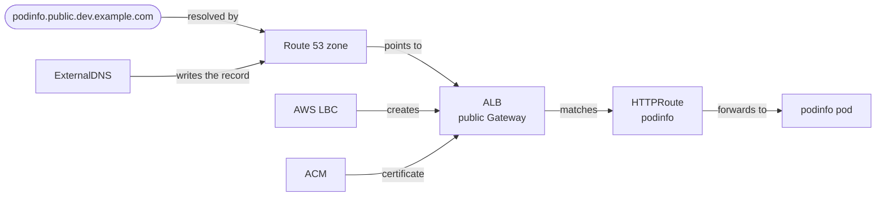
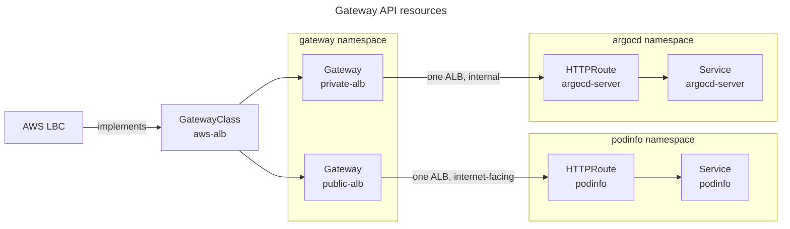
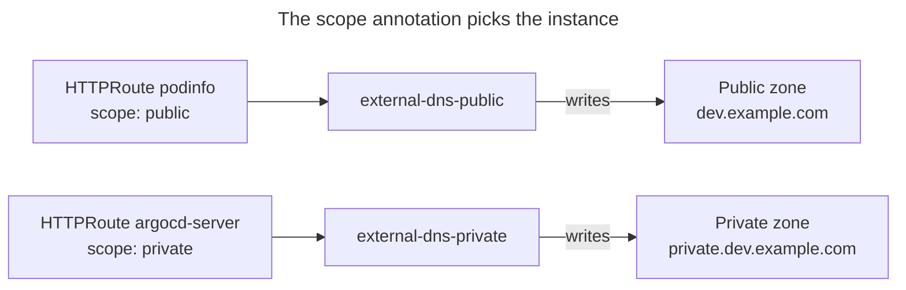
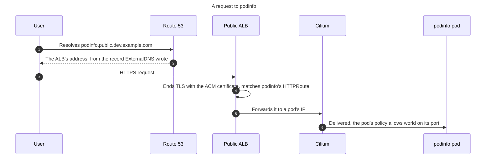
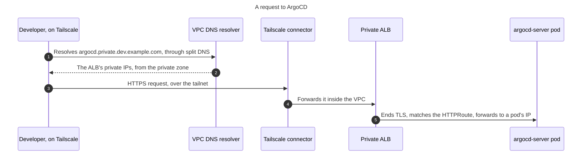

# How Ingress Works

EKS Forge exposes your apps through two gateways, one public and one private, each backed by an [Application Load Balancer](https://aws.amazon.com/elasticloadbalancing/application-load-balancer/) (ALB). This page explains why there are two, and how a request travels from a hostname to a pod.
For the steps to expose your own app, see [Expose an App](/docs/networking/expose-an-app/).

## Overview
A hostname resolves in [Route 53](https://aws.amazon.com/route53/) to an ALB. The ALB matches the request against an [`HTTPRoute`](https://gateway-api.sigs.k8s.io/reference/api-types/httproute/), and forwards it to the pod behind it. Three controllers set up this chain: the [AWS Load Balancer Controller](https://kubernetes-sigs.github.io/aws-load-balancer-controller/latest/) (AWS LBC) creates the ALB, [ExternalDNS](https://kubernetes-sigs.github.io/external-dns/) writes the DNS record, and [ACM](https://aws.amazon.com/certificate-manager/) provides the TLS certificate.

The pieces are split between two repositories, like everything that runs in the cluster (see [Who Owns What](/docs/applications/how-the-app-of-apps-works/#who-owns-what)). The catalog creates the AWS side: the hosted zones, the certificate, and each app's hostname. The app of apps repository deploys the Kubernetes side: the Gateways, the routes, and ExternalDNS.

## Public and Private Scopes
Every route belongs to one of two scopes. The public scope is for the apps your users reach, like podinfo. Its ALB is `internet-facing`, and its records sit in a public hosted zone, so anyone on the internet can resolve and reach it.

The private scope is for the internal tools: ArgoCD, Grafana, Prometheus, Alertmanager, Hubble, and Goldilocks. Its ALB is `internal`, with no public IP, and its records sit in a private hosted zone that only the VPC can query.

This split is deliberate. The internal tools hold the keys to the cluster: ArgoCD deploys anything, and Grafana shows every log. Behind a public ALB, a weak password or an unpatched login page is all that stands between them and the internet. In the private scope, a request from the internet can't even resolve their hostname, and couldn't reach their ALB if it did.

The trade-off is access. A developer outside the VPC needs a way in, which is what [Tailscale](/docs/networking/tailscale/) provides (see [The Private Request Path](#the-private-request-path)).

| | ALB scheme | Hosted zone | Hostname | Reached from | Examples |
|---|---|---|---|---|---|
| **Public** | `internet-facing` | `<env>.<base_domain>`, public | `<subdomain>.public.<env>.<base_domain>` | The internet | podinfo |
| **Private** | `internal` | `private.<env>.<base_domain>`, private | `<subdomain>.private.<env>.<base_domain>` | The VPC, or Tailscale | ArgoCD, Grafana, Goldilocks |

## Hostname Layout
Every hostname follows the same pattern, `<subdomain>.<scope>.<env>.<base_domain>`, like `podinfo.public.dev.example.com`. The catalog builds it from two files: [`pipelines/dns.hcl`](https://github.com/ConsciousML/eks-forge-catalog/blob/main/pipelines/dns.hcl) holds the base domain and each app's subdomain, and [`domains.hcl`](/docs/reference/hcl_configuration/#domainshcl) adds the scope and the environment.

Each environment owns its own subdomain of your domain. The [DNS bootstrap](/docs/quickstart/bootstrap/setup_dns/) creates a public hosted zone for `<env>.<base_domain>`, and you delegate it from your registrar. Public hostnames live in that zone. The catalog then creates the private zone, `private.<env>.<base_domain>`, attached to the environment's VPC. Each environment's records then stay in its own zones, and destroying `dev` leaves `prod`'s records alone.

### The Wildcard Certificate
Both ALBs serve the same ACM certificate, issued for `*.<env>.<base_domain>`, with `*.public.<env>.<base_domain>` and `*.private.<env>.<base_domain>` as alternative names (see the [`acm_certificate` unit](https://github.com/ConsciousML/eks-forge-catalog/blob/main/units/eks/route53/acm_certificate/terragrunt.hcl)). A new app gets HTTPS without a certificate of its own: its hostname already matches a wildcard.

ACM validates every name through records in the public zone, private names included, since ACM checks them from the internet. That's why the private zone needs no record of its own for the certificate.

The trade-off is depth. A wildcard covers a single label, so `api.podinfo.public.dev.example.com` isn't covered, and a subdomain can't contain a dot.

### Why the Catalog Injects the Hostname
A hostname depends on your fork's domain and on the environment, two things the app of apps repository doesn't know. So the `httproute` chart has no default `host`: the catalog passes it to each route through [`appParams`](/docs/applications/how-the-app-of-apps-works/#appparams-injection), and the same chart serves `dev`, `staging`, and `prod`.

It also keeps a single source for each hostname. `domains.hcl` feeds the route, the [blackbox exporter](/docs/networking/expose-an-app/#probe-the-hostname)'s probe, and the `domain_name` unit the infrastructure tests read (see [Add a Domain Name Unit](/docs/iac/add-a-domain-name-unit/)). Renaming an app's subdomain then moves all three together.

## Gateway API
EKS Forge routes traffic with [Gateway API](https://gateway-api.sigs.k8s.io/), not with [Ingress](https://kubernetes.io/docs/concepts/services-networking/ingress/), for three reasons:
- **It splits the roles.** The platform owns the Gateways, with their ALB, scheme, and certificate. An app only ships an `HTTPRoute`, in its own namespace, and can't change the load balancer it attaches to.
- **One Gateway is one ALB.** Every route attached to a Gateway shares its ALB, and the ALB is configured by typed resources. With Ingress, the AWS LBC groups resources into one ALB through annotations repeated on each of them.
- **Ingress is frozen.** Kubernetes no longer adds features to the Ingress API, and points to Gateway API as its successor.

The `aws-alb` [`GatewayClass`](https://gateway-api.sigs.k8s.io/reference/api-types/gatewayclass/) hands every Gateway of that class to the AWS LBC. Both Gateways come from the same [`gateway` chart](/docs/reference/helm_charts/gateway-api/gateway/), each with its own values file, and the AWS LBC turns each one into an ALB from two of its own resources:
- A `LoadBalancerConfiguration`, which sets the ALB's scheme, `internet-facing` or `internal`, and the certificate of its HTTPS listener.
- A `TargetGroupConfiguration`, which sets `targetType: ip`. The ALB then sends each request straight to a pod's IP, skipping the node and the `Service`'s load balancing (see [The `world` Entity](/docs/security/how-network-policies-work/#the-world-entity) for what this means to Cilium).

The Gateways live in the `gateway` namespace, but the routes don't. An `HTTPRoute` can only send traffic to a `Service` in its own namespace, so each route sits next to its app, and each Gateway's listeners accept routes from every namespace.

Every route uses the same [`httproute` chart](/docs/reference/helm_charts/gateway-api/httproute/), with one Application and one values file per app (see [The Root App and Its Children](/docs/applications/how-the-app-of-apps-works/#the-root-app-and-its-children)). The values file names the `Service`, and the Gateway's values file, loaded next to it, names the Gateway to attach to.

The order matters, so [sync waves](/docs/applications/how-the-app-of-apps-works/#sync-waves) encode it. The `GatewayClass` syncs at wave `5`, after the AWS LBC that accepts it. Both Gateways follow at wave `6`. A route syncs after both its Gateway and its app, since it attaches to one and points at the other.

## DNS
ExternalDNS watches the `HTTPRoute`s of the cluster, and writes a record for each hostname into Route 53. EKS Forge runs two instances of it, `external-dns-public` and `external-dns-private`, from the same [`external-dns` chart](/docs/reference/helm_charts/external-dns/). Each has its own IAM role, through [EKS Pod Identity](https://docs.aws.amazon.com/eks/latest/userguide/pod-identities.html).

Each instance is tied to one scope from both ends:
- **The zone it writes to.** `aws-zone-type` limits it to public or private zones, and `domainFilters`, injected by the catalog, to the environment's zone of that type.
- **The routes it reads.** `annotationFilter` limits it to the routes whose `external-dns.alpha.kubernetes.io/scope` annotation matches its scope, `public` or `private`.

The zone filters alone wouldn't keep the scopes apart. A [domain filter](https://kubernetes-sigs.github.io/external-dns/latest/docs/advanced/domain-filter/) matches by suffix, and `private.dev.example.com` ends in `dev.example.com`. Without the annotation, the public instance would also pick up `argocd.private.dev.example.com`, and publish it in the public zone, where anyone could resolve it. The annotation is what keeps a private hostname out of public DNS.

Each instance also marks the records it owns, with a TXT record next to each one. The owner is the cluster's name, and each instance adds a prefix of its own, so neither instance touches the records of the other, or of another cluster. With the `sync` policy, an instance deletes a record when its route goes away, and leaves every record it doesn't own alone.

The trade-off is that nothing checks the annotation against the Gateway. A route attached to the private Gateway with a `public` annotation gets a public record pointing at an internal ALB, and a route with no annotation gets no record at all. A new record also takes about a minute to appear, while ExternalDNS catches up.

## The Public Request Path
Each piece above sets up a single link of the chain. A request to podinfo goes through all of them:

The ALB isn't a pod, so Cilium sees its requests as coming from `world`, and the pod's network policy has to allow `world` on the port the app serves on. Two layers keep this narrow: the node's security group only lets the ALB in, and the policy only opens that one port (see [The `world` Entity](/docs/security/how-network-policies-work/#the-world-entity)). For the rule itself, see [Allow Gateway Traffic](/docs/networking/expose-an-app/#allow-gateway-traffic).

## The Private Request Path
A request to an internal tool follows the same chain, through the private Gateway. What differs is how it gets into the VPC. Your machine can't query the private zone, and can't route to the internal ALB, so Tailscale bridges both gaps:
- **Split DNS** sends the queries for `private.<env>.<base_domain>` to the VPC's DNS resolver, over the tailnet.
- **The connector**, run by the Tailscale operator in the cluster, advertises the VPC's CIDR as a route of the tailnet, so packets to the ALB's private IPs go through it.

For how the connector and split DNS are set up, see [Connector and Split DNS](/docs/networking/tailscale/#4-connector-and-split-dns).

## How the Chain Is Checked
A broken link anywhere in the chain looks the same from outside: the hostname doesn't answer. So EKS Forge checks the whole chain at once, from both sides. The blackbox exporter requests each hostname from inside the cluster, and alerts when one stops answering (see [Probe the Hostname](/docs/networking/expose-an-app/#probe-the-hostname)). The infrastructure tests request it from outside, after each deployment of `staging` and `prod`. One `200` proves the record, the certificate, the ALB, the route, the network policy, and the pods all work (see [What a Passing Check Proves](/docs/ci-cd/testing/how-the-infrastructure-tests-work/#what-a-passing-check-proves)).

For the values behind each piece, see the [`gateway`](/docs/reference/helm_charts/gateway-api/gateway/), [`httproute`](/docs/reference/helm_charts/gateway-api/httproute/), and [`external-dns`](/docs/reference/helm_charts/external-dns/) Helm chart references.
